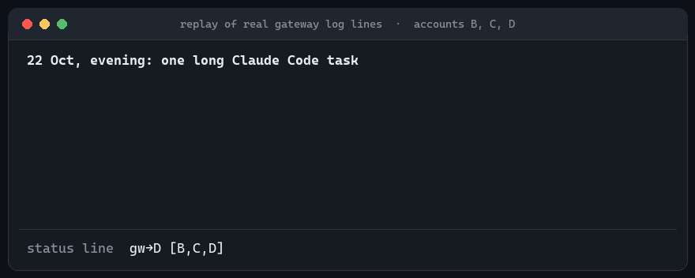
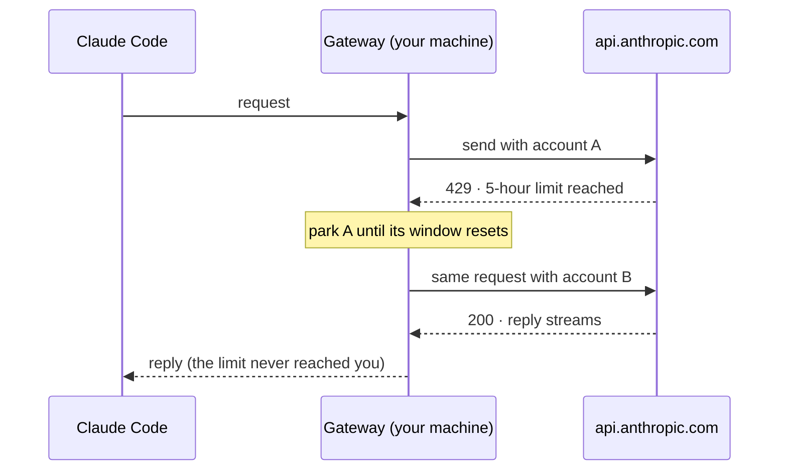

<div align="center">

# Claude Code Account Switcher and Auto continue on time expiery

**Auto-switch between your Claude accounts when one hits its usage limit.<br>
When they are all full, auto-continue the chat the moment the first limit expires (terminal).**

[](https://www.npmjs.com/package/claude-code-account-switcher)


</div>

Claude Code stops when your plan hits its 5-hour or weekly limit. If you have more than one Claude account, this
tool keeps all of them ready: a small gateway on your own machine sends each request through the account that
still has room, and moves to the next one the moment a limit is hit. You keep working; the chat never sees the
wall. And if every account is full, a terminal chat waits and **continues by itself as soon as the first account's
limit expires**, with nobody typing "continue".

It works with the **Claude Code CLI and the VS Code extension**, without modifying Claude Code: it uses Claude
Code's documented `ANTHROPIC_BASE_URL` setting to point it at `http://127.0.0.1:8790`.

<p align="center">
  
  <br><sub>Replayed from a real gateway log (21 and 22 October 2026). The status line is the tool's own.</sub>
</p>

**Install** (Node.js 20+, no admin or sudo needed):

```bash
npm install -g claude-code-account-switcher                     # Windows
npm install -g --prefix ~/.local claude-code-account-switcher   # Linux
```

Then add your other accounts and turn it on: three short steps in the [Quick start](#quick-start).

## What you get

| | |
|---|---|
| 🔄 **Auto-switch** | When the account in use fills a 5-hour or weekly window, the request is re-sent on another account *before any reply has streamed*, so even the request that hit the limit gets answered. |
| ▶️ **Auto-continue when a limit expires** *(terminal)* | When every account is full, the terminal chat shows *"continuing automatically at …"*, waits, and carries on by itself at the moment the **first** account's limit expires, not when the account it happened to be on does. The VS Code panel cannot auto-continue; there the gateway holds the reply open for up to 10 minutes instead. |
| 🧠 **Knows its limits** | Tells a full window apart from a limit on one model or a passing error, so a healthy account is never parked for days by mistake. Stays on one account until it is actually blocked, which keeps the prompt cache warm. |
| 👀 **Always visible** | A VS Code status-bar item showing every account, a terminal status line, desktop notifications when it switches, and `cla-gw health`. |
| 🎛️ **Manual override** | `/switch` inside Claude Code (or `cla-gw switch`) to pick the account yourself. |
| 💵 **Cost view** | What your traffic would have cost on the pay-as-you-go API, per model, day and account. |

Zero dependencies: plain Node.js, one local process, listening on `127.0.0.1` only.

## How it works



Every response from Anthropic carries the account's usage in its headers, so the gateway learns how full each
account is from your own traffic, without polling anything.

## Quick start

You need **Node.js 20+** (it comes with npm; check with `node -v`) and **Claude Code**, signed in. Account `A` is
the login Claude Code already has; you add the others.

### 1. Install

**Windows** (PowerShell, no admin needed)

```powershell
npm install -g claude-code-account-switcher
```

**Linux** (no sudo)

```bash
npm install -g --prefix ~/.local claude-code-account-switcher   # puts `cla-gw` in ~/.local/bin
```

**Check it worked:** run `cla-gw`. A new install answers `gateway: NOT RUNNING`; you start it in step 2.

> **Linux: `cla-gw: command not found`?** `~/.local/bin` isn't on your PATH yet. Ubuntu adds it at login once the
> folder exists, so log out and back in, or run `export PATH="$HOME/.local/bin:$PATH"` (put that line in
> `~/.bashrc` to keep it).

Install it globally (`-g`), not with `npx`: the gateway runs in the background and starts at login, so it needs a
permanent home.

<details>
<summary><b>Or install from source</b> (to read or change the code)</summary>

```bash
git clone https://github.com/markmircea/claude-code-account-switcher.git
cd claude-code-account-switcher
npm install -g .                                               # Windows
npm install -g --prefix ~/.local --install-links=false .       # Linux
```

Keep the folder: the `cla-gw` command links to it, so after a `git pull` (or your own edits) a restart is all it
takes: `cla-gw stop && cla-gw start`. Check everything works with `npm test` (offline, under a minute). On Linux,
`--install-links=false` matters: Ubuntu's npm 9 otherwise copies the folder, and your edits never reach the gateway.

</details>

### 2. Add your other accounts

```bash
cla-gw start      # start the gateway in the background
cla-gw add B      # prints a sign-in link: open it in a PRIVATE browser window and log in as account B
cla-gw add C      # ...as many as you have
cla-gw check      # one tiny request per account: can each one actually answer?
```

> **Why a private window?** The sign-in page hands back whichever Claude account your browser is already logged
> into. In a normal window, "adding B" silently adds A again. (The tool tries to catch this, but a private window
> avoids it.)

### 3. Turn it on

```bash
cla-gw activate   # point Claude Code at the gateway and start it automatically at login
cla-gw doctor     # checks every link in the chain; run this first whenever something looks off
```

Then restart Claude Code so it picks up the change:

- **Windows:** quit VS Code completely and start it again, and open a new terminal.
- **Linux:** run **Developer: Reload Window** in VS Code, and start a new `claude` in the terminal.

**Using VS Code?** `cla-gw install-extension` adds a status bar showing every account (see
[What you'll see](#what-youll-see)). **Want `/switch` inside Claude Code?** Run `cla-gw install-slash`.

**To turn it off:** `cla-gw deactivate` puts everything back the way it was.

### Update or uninstall

**Update** to the latest version, then restart the gateway so it runs the new code:

```bash
npm install -g claude-code-account-switcher@latest                    # Windows
npm install -g --prefix ~/.local claude-code-account-switcher@latest  # Linux
cla-gw stop && cla-gw start
```

If you switch Node versions (for example with nvm), install it again under the new one and run `cla-gw activate`, so
the autostart points at the new Node.

**Uninstall:**

```bash
cla-gw deactivate                                    # stop it, remove the autostart, point Claude Code back at Anthropic
npm uninstall -g claude-code-account-switcher        # Linux: add --prefix ~/.local
```

Your account tokens and settings stay behind in `%LOCALAPPDATA%\claude-gw` (Windows) or `~/.local/share/claude-gw`
(Linux): delete that folder to remove them too. The status bar goes with
`code --uninstall-extension local.claude-gw-status`, and `/switch` by deleting `~/.claude/commands/switch.md`.

## Everyday commands

| Command | What it does |
|---|---|
| `cla-gw status` | Is it running, which account is next, requests per account |
| `cla-gw health` | How full each account is, when each one resets, why one is parked |
| `cla-gw switch` | List accounts and pick one by hand (`cla-gw switch c`, `switch next`, `switch off`) |
| `cla-gw disable B` / `enable B` | Take an account out of rotation for a while, or put it back |
| `cla-gw check` | Ask every account for one token right now |
| `cla-gw cost` | What the traffic would have cost on the API |
| `cla-gw doctor` | Diagnose the setup |
| `cla-gw deactivate` | Turn everything off |

<details>
<summary><b>Full command reference</b></summary>

| Command | What it does |
|---|---|
| `start` / `stop` / `status` | Run or stop the gateway; `status` shows the pool, the pin and request counts |
| `health` | Per-account usage from real traffic: utilisation, resets, park reason, model limits |
| `check [labels]` | One 1-token request per account. Exit code 1 if any account cannot answer |
| `ls` | List accounts and their credential type |
| `add <label> [--paste\|--auto]` | Add an account via `claude setup-token` in a separate config folder. A test request runs first: a rejected token is not added; an account that cannot answer yet (e.g. new terms to accept) is added switched off |
| `email <label> <addr>` | Note which email an account belongs to (shown in `ls`, `health` and the status bar) |
| `enable <label>` / `disable <label>` | Put an account in or out of rotation, instantly, without deleting it |
| `forget <label> --yes` | Delete the account's local entry and stored token. This does **not** revoke the token at claude.ai |
| `switch [label\|number\|next\|off]` | Pick the serving account by hand; `off` hands control back to the automatic rules |
| `use <label>\|none` | Pin an account (`none` = automatic) |
| `install-slash [name]` | Add the `/switch` command to Claude Code (never overwrites a different file) |
| `install-extension [--print]` | Build the VS Code status bar extension and install it with `code`; `--print` gives the file and command instead |
| `activate [--no-startup\|--legacy]` | Point Claude Code at the gateway and install the autostart |
| `deactivate` | Undo `activate` and stop the gateway |
| `doctor` | Check the environment, Claude Code settings, login, gateway and autostart; exit code 1 on a problem |
| `run -- <claude args>` | One Claude session that bypasses the gateway |
| `env` / `clear-env` | Print the lines that point (or stop pointing) the current shell at the gateway |
| `statusline` | Print the status-line snippet for `~/.claude/settings.json` |
| `cost [--days N]` / `prices` | API-equivalent cost per model, day and account / the price table behind it |
| `audit routing [--hours N]` | Check the real traffic log against the routing rules; exit code 1 on a violation |
| `reset-state` | Forget learned usage data (the gateway picks this up without a restart) |
| `notify` | Show a test notification |

`node src/cli.mjs <command>` works anywhere `cla-gw <command>` does.

</details>

## What you'll see

**VS Code status bar.** The Claude Code panel has no status line of its own, so a small extension in `vscode/`
shows the whole pool at the bottom of the window:

```
gw: ✓ C 51%/87% · B ?/9% · D ?/40% · ≥$76.17 api
```

✓ = serving now · `51%/87%` = 5-hour / weekly usage · `?` = not seen since its window reset · `⛔ 04:00` =
blocked until then · `⚠terms` = someone must accept new terms on claude.ai · `off` = disabled · `⏳ 2 held` =
chats waiting for an account to reopen · a red **claude-gw DOWN** if the gateway stops. Hover for a per-account
table and the API-equivalent cost for the last day, week, month and all time; click to run `cla-gw health`.

```bash
cla-gw install-extension     # builds the extension and installs it with VS Code's `code` command
```

then **Developer: Reload Window**. If `code` isn't on your PATH, `cla-gw install-extension --print` gives you the
file and the command to run by hand.

**Terminal status line.** Run `cla-gw statusline` and paste the printed block into `~/.claude/settings.json`:

```
gw→C 5h 51% 7d 87% [B,C,D]
```

the account serving *this* conversation, its usage, and the pool. When everything is full it adds
`| all full, D opens 06:00`.

**`/switch` in Claude Code.** After `cla-gw install-slash`: `/switch` lists the accounts, `/switch c` or
`/switch 2` picks one, `/switch next` moves on, `/switch off` returns to automatic. It is plain shell that runs
before the model sees anything, and the model cannot trigger it on its own.

> Claude Code's own `/usage` and account badge always show **your login**, not the account that served the
> request. Use the status bar, the status line or `cla-gw health` instead.

## How it chooses an account

1. **Stay put.** Requests stay on the current account however full it gets, until a window actually blocks it.
   Switching costs a full re-send of the conversation, because the prompt cache belongs to one account.
2. **A full window moves everything.** A quota `429` parks the account until its *last* blocked window clears
   (a 5-hour window that refills tonight doesn't help if the weekly one is full until Friday). The request goes to
   the least-used open account, which becomes the new current one.
3. **One model limited? Take a detour.** If Anthropic refuses one model on an account whose windows look fine,
   only that model is routed elsewhere, for 15 minutes at first, longer if it keeps happening. The account stays.
4. **A passing error parks for a minute**, never for days.
5. **Everything full:** the request goes to whichever account reopens first, and Claude Code gets the real limit
   message with the reset time rewritten to that moment, so its auto-continue fires as early as possible.

<details>
<summary><b>The details</b></summary>

- The usage data comes from the `anthropic-ratelimit-unified-{5h,7d}-*` headers that come back on every response,
  success or error, and is stored per account in `accounts_state.json`. Nothing is polled, which matters because a
  `setup-token` is not allowed to read the usage endpoint at all.
- Three kinds of `429` are told apart: a full window (park until the last blocked window resets), a model-level
  refusal with nothing rejected in the headers (gate that model on that account: 15 min, then 1 h, then 4 h; any
  success clears it), and a bare error with no quota headers (park for 60 s, or `retry-after` up to 15 min).
- A request is re-sent on another account only before the first byte of the reply reaches Claude Code. After
  that it is never retried: that would duplicate text and bill twice.
- An account that cannot answer at all, for example one waiting for you to accept new terms on claude.ai, is
  parked and flagged `⚠terms` with instructions.
- Two accounts that turn out to be the same one (same organisation id) are reported.
- `overage-status: rejected` is not treated as "full": it appears on successful responses too and only means
  buying extra usage is switched off.
- With no account enabled at all, requests fail fast with `503 empty-rotation` instead of hanging.
- Only `/v1/messages` is re-signed with a pool account. Other calls (model list, account info) keep Claude Code's
  own login, because an added account's token is only allowed to run inference.

</details>

## How auto-continue works (when a limit expires)

**In the terminal.** When Claude Code hits a limit it shows *"Usage limit reached · continuing automatically at
…"*, waits until the limit expires, then sends the next message by itself. The gateway's job is to make that time describe **all** your
accounts: it rewrites only the reset time in the limit message to the earliest reopening across the pool, and never
makes a wait longer than Anthropic said.

**Short waits are skipped.** If an account reopens within 45 seconds, the request is simply held and then
answered.

**In the VS Code panel.** The panel runs Claude Code in a mode that does *not* auto-continue after a limit, so
for long waits (an hour, overnight) use a terminal chat. For short waits the gateway helps the panel anyway: it
answers at once, keeps the connection alive, and streams the real reply in when an account
reopens, up to 10 minutes later. The 10-minute ceiling is deliberate: Claude Code abandons a held reply at about 15
minutes, and past the ceiling the gateway passes the limit through straight away so a terminal chat can still set
its own timer.

It cannot revive a panel chat you stopped, a window you closed, or a laptop that slept through the reset.

## What would this have cost on the API?

Your subscription is a flat fee, but the gateway sees every token, so it can price them at Anthropic's API list
rates:

```bash
cla-gw cost --days 7   # per model, per day, per account, in tokens and dollars
cla-gw prices          # the price table and the date it was copied
```

<details>
<summary><b>How the numbers are worked out</b></summary>

- Prices are per exact model id, from a dated table (`PRICES_AS_OF` in `src/config.mjs`). A model the table does
  not know is shown as **UNPRICED**, never guessed.
- Multipliers are read off each response: cache writes (5-minute vs 1-hour), cache reads, fast mode, US-only
  inference, long-context tiers. Web searches are priced per search; web fetches are counted but not priced.
- Every total says how much of the traffic it covers (`N priced of M`). Replies cut off before their final token
  count make the figure a minimum, shown as `≥`.
- Add or override prices in `config.json` under `"prices"`.

</details>

## Windows and Linux

Same code and same commands on both; only the plumbing differs.

| | Windows | Linux |
|---|---|---|
| Data folder | `%LOCALAPPDATA%\claude-gw` | `~/.local/share/claude-gw` |
| Stored tokens | encrypted with DPAPI (`vault\<label>.dpapi`) | a file only you can read (`vault/<label>.token`, 0600 in a 0700 folder); refused if its permissions are ever widened |
| Points Claude Code at the gateway | user environment variables + the `env` block in `~/.claude/settings.json` | the `env` block in `~/.claude/settings.json` + `~/.config/environment.d/90-claude-gw.conf` for desktop apps |
| Starts at login | `claude-gw.cmd` in the Startup folder | systemd user service `claude-gw.service`, which also restarts the gateway if it crashes |
| Start / stop | `cla-gw start` / `stop` | the same; they go through `systemctl --user` once the service is installed |
| Logs | `gateway.jsonl` in the data folder | the same, plus `journalctl --user -u claude-gw` |
| Notifications | a popup window | `notify-send` (needs a desktop session; skipped quietly over SSH) |
| `cla-gw add` runs | `%USERPROFILE%\.local\bin\claude.exe` | `~/.local/bin/claude` (set `CLAUDE_BIN` to override) |

Tested on **Windows 11** and **Ubuntu 26.04** with Claude Code 2.1.300 to 2.1.306.

<details>
<summary><b>Configuration</b></summary>

`config.json` in the data folder is created on first start and re-read on every request, so edits apply without a
restart.

| Key | Default | Meaning |
|---|---|---|
| `host`, `port` | `127.0.0.1`, `8790` | Listen address (loopback only) |
| `upstream` | `https://api.anthropic.com` | Where requests go |
| `secret` | random | Local password Claude Code must send; generated on first run |
| `secretHeader` | `x-gw-secret` | Header that carries it |
| `swapInferenceOnly` | `true` | Re-sign only `/v1/messages` |
| `active` | `null` | Pinned account; `null` = automatic |
| `holdMaxMs` | `45000` | Hold a request this long if an account is about to reopen; `0` turns it off |
| `holdStream` | `true` | Hold streaming replies (the VS Code panel) |
| `holdStreamMaxMs` | `600000` | Ceiling for that hold; keep it under Claude Code's ~15-minute abandon point |
| `accounts` | `[A]` | `{ label, kind: "cli-credential" \| "vault", enabled, identity }` |
| `prices` | none | Price overrides for `cost` |

Environment variables: `CLAUDE_GW_DATA_DIR` moves the data folder (the tests use it), `CLAUDE_GW_NO_NOTIFY=1`
turns notifications off, `CLAUDE_BIN` sets the `claude` that `add` runs.

</details>

<details>
<summary><b>Every file it reads or writes</b></summary>

Paths are shown for Windows; on Linux the data folder is `~/.local/share/claude-gw`.

| Path | What |
|---|---|
| `<data>/config.json` | Settings and the account list |
| `<data>/vault/<label>.dpapi` (`.token` on Linux) | Added accounts' tokens |
| `<data>/provision/<label>/` | The separate Claude config folder `add` signs in from |
| `<data>/accounts_state.json` | Usage learned per account |
| `<data>/status.json` | Live snapshot for the status bar and status line |
| `<data>/gateway.jsonl` | Request log: paths, statuses, accounts, timings, token counts. Never tokens or secrets |
| `<data>/gateway.pid` | The running gateway's process id |
| `~/.claude/.credentials.json` | Account `A`, your Claude Code login. **Read only** |
| `~/.claude.json` | Read only, to show which account Claude Code is signed in as |
| `~/.claude/settings.json` | `activate` adds three `env` keys (backup: `settings.json.claude-gw.bak`); `deactivate` removes them |
| `~/.claude/commands/switch.md` | Written by `install-slash` only |
| Windows: user environment variables | `CLAUDE_CODE_USE_GATEWAY`, `ANTHROPIC_BASE_URL`, `ANTHROPIC_CUSTOM_HEADERS` |
| Windows: Startup folder `claude-gw.cmd` | Autostart (`activate --no-startup` skips it) |
| Linux: `~/.config/environment.d/90-claude-gw.conf` | The same variables for desktop apps (mode 0600) |
| Linux: `~/.config/systemd/user/claude-gw.service` | Autostart |

</details>

## Security

- **Local only.** The gateway listens on `127.0.0.1`, checks the caller's address and `Host` header, and requires a
  random local password on every request (compared in constant time, removed before anything is forwarded).
- **Your login stays Claude Code's.** Account `A`'s credential file is only ever read; Claude Code refreshes it.
- **Added accounts** use 1-year, inference-only tokens from `claude setup-token`, stored encrypted (Windows) or in
  a private file (Linux). That protects them on disk, not from a program already running as you.
- **Why no `ANTHROPIC_AUTH_TOKEN`:** if that variable is set, Claude Code treats the session as pay-as-you-go API
  and switches off its own auto-continue. The local password travels in a separate header instead, and `doctor`
  warns if the variable is present. (`activate --legacy` uses the old token mode anyway.)
- **The gateway must be running** while it is activated, or Claude Code cannot reach Anthropic at all. That is why
  it starts at login and why the status bar turns red when it stops. `cla-gw deactivate` is the off switch.
- `disable` and `forget` are local. If a token was ever exposed, revoke it at claude.ai.

## Troubleshooting

<details>
<summary><b>I activated it and nothing changed</b></summary>

Programs that were already running keep their old settings. On Windows quit VS Code completely and open a new
terminal; on Linux run **Developer: Reload Window** and start a new `claude`. Then `cla-gw doctor`.

</details>

<details>
<summary><b>Claude Code can't connect at all</b></summary>

The gateway is probably not running: `cla-gw start`, then `cla-gw doctor`. To go back to a direct connection, run
`cla-gw deactivate`.

</details>

<details>
<summary><b>Adding account B gave me account A again</b></summary>

Your browser was still logged in as A. `cla-gw forget B --yes`, then `cla-gw add B` and open the link in a private
window.

</details>

<details>
<summary><b>An account shows ⚠terms</b></summary>

Anthropic wants that account to accept updated terms. Sign in to claude.ai as that account, accept them, then
`cla-gw enable <label>`. `cla-gw email <label> <address>` makes it obvious which account that is.

</details>

<details>
<summary><b>/usage shows the wrong account</b></summary>

Expected: `/usage` always reports your own login. The status bar, status line and `cla-gw health` show the account
that actually served you.

</details>

## Tests

```bash
npm test     # from a source checkout
```

runs eleven offline suites (268 checks) that never touch a running gateway or your accounts: account selection and
the three kinds of `429`, the routing rules, sticky routing end to end against a fake Anthropic server, the reset-time
rewrite and both holds, token capture from real responses and pricing, what the status bar renders, safe config
writes, `/switch`, a port held by another program, the VS Code extension build, and the npm package itself (packed, installed into a scratch folder
whose path has a space in it, and run from there).

<details>
<summary><b>The other test and probe scripts</b></summary>

- `src/test_replay.mjs`, `src/smoke-sse.mjs`: briefly point the **running** gateway at a fake server. Run them only
  when no real chat is using it.
- `src/smoke-vault.mjs`: writes a test token into the real vault folder.
- `src/smoke.mjs`, `src/failover_test.mjs`: send tiny requests to the real API.
- `src/probe_upstream.mjs` stands in for api.anthropic.com and can play "out of usage, reopens in N minutes", so
  the whole limit-and-resume flow can be rehearsed against the real Claude Code without spending usage.
  `src/probe_long_hold.mjs` does the same for the VS Code panel. Re-run them after a Claude Code update: how the
  client reacts to limits is the part most likely to change.

</details>

## Known limits

- Claude Code's `/usage` and account badge keep showing your own login.
- A VS Code panel chat can be held for at most ~10 minutes; after that it needs a "continue" from you.
- `setup-token`s last about a year and do not refresh: add the account again when one expires.
- Behaviour around limits depends on how Claude Code handles them, which can change between releases.
- `activate` on Linux has seen less real-world use than on Windows.

## License

[Apache License 2.0](LICENSE). The command and data folder are named `claude-gw` (short for *Claude gateway*).

This is an independent project, not affiliated with or endorsed by Anthropic.
